<div align="center">

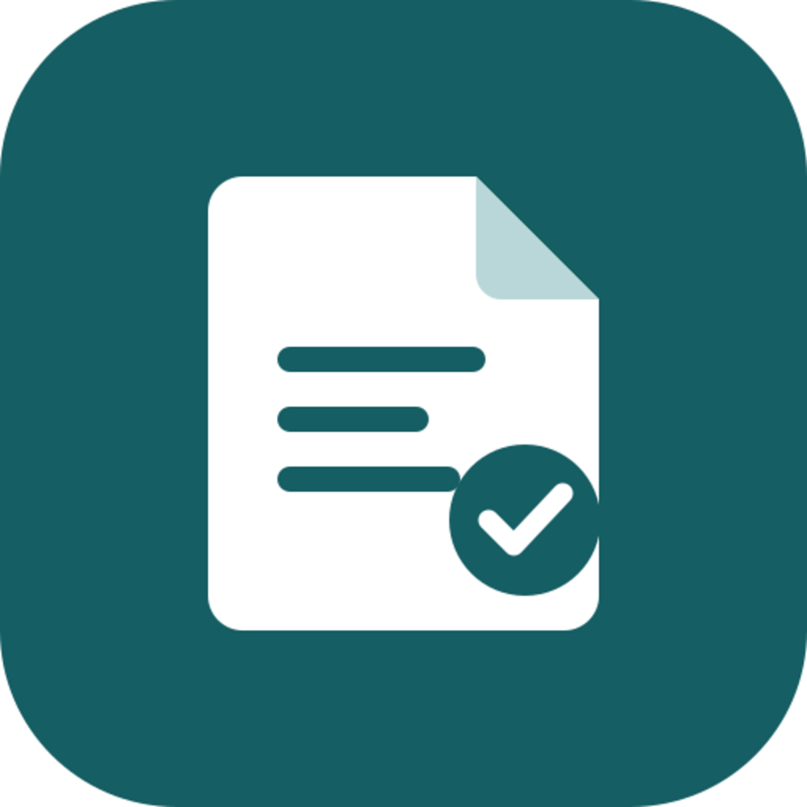

# ورقتك · Waraqatak

**Invoices, quick sales, stock and accounting for small businesses — offline, in Arabic and English.**

[](https://play.google.com/store/apps/details?id=com.elmahdi.waraqatak)
[](pubspec.yaml)
[](docs/play-compliance.md)
[](.github/workflows/ci.yml)
[](https://github.com/almhdy24/waraqatak/actions/workflows/ci.yml)

[Get it on Google Play](https://play.google.com/store/apps/details?id=com.elmahdi.waraqatak) ·
[Website](https://almhdy24.com) ·
[Privacy policy](https://almhdy24.com/products/waraqatak/privacy.html) ·
[Full feature tour](docs/showcase/README.md)

</div>

Waraqatak (ورقتك, "your paper") is an Android app for shops and service
businesses that need to issue invoices, take quick sales, track stock and
see where the money stands, without depending on an internet connection.
Everything is stored on the device. Arabic (RTL) and English are both
first-class.

<table>
  <tr>
    <td>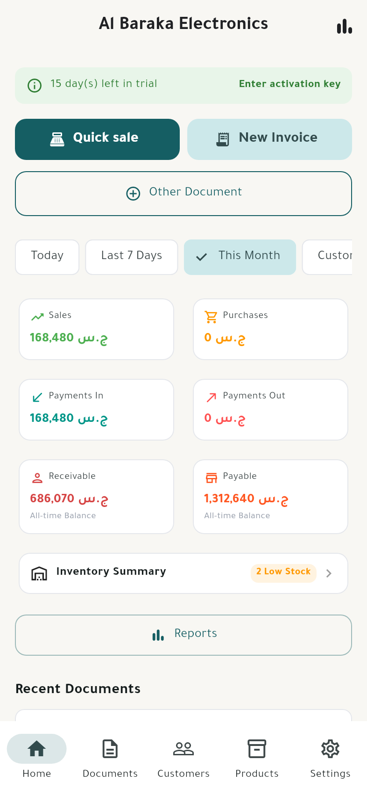</td>
    <td>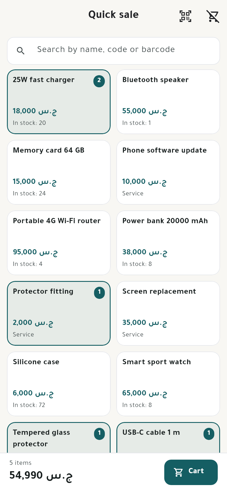</td>
    <td>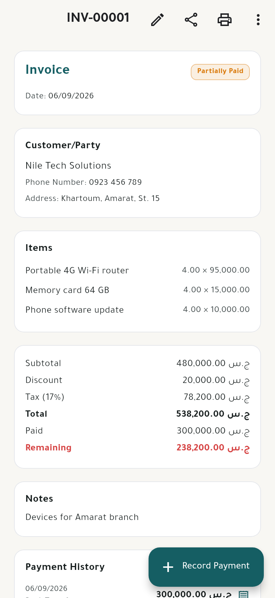</td>
    <td>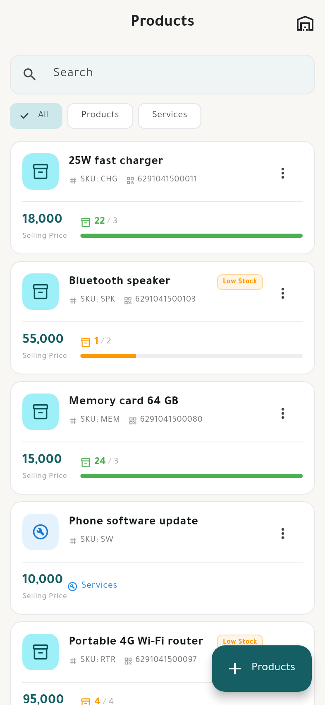</td>
  </tr>
  <tr>
    <td align="center"><sub>Dashboard</sub></td>
    <td align="center"><sub>Quick sale</sub></td>
    <td align="center"><sub>Invoice &amp; payments</sub></td>
    <td align="center"><sub>Products &amp; stock</sub></td>
  </tr>
</table>

## Screenshots

All screenshots are real captures of the app. The data is a fictional demo
store ("Al Baraka Electronics"); names and numbers are made up. More
screens, in both languages, are in the [feature tour](docs/showcase/README.md).

**Phone**

| Quick sale cart | Invoice PDF (A4) | PDF design | Inventory · Pro | Balance sheet · Pro |
|:--:|:--:|:--:|:--:|:--:|
| 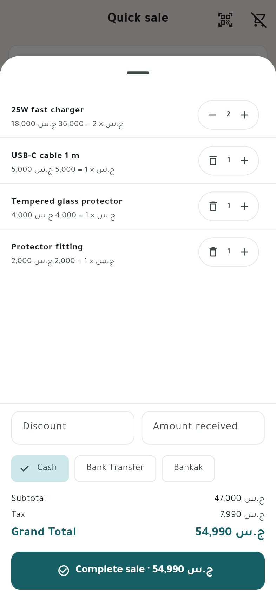 | 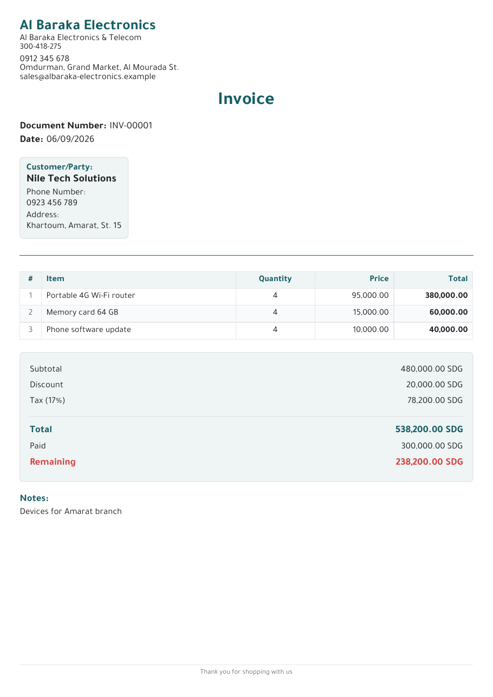 | 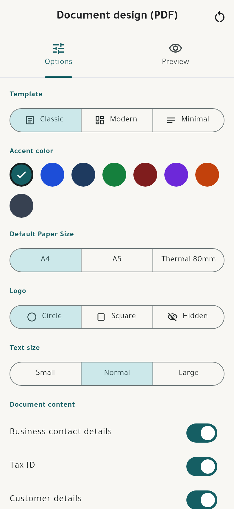 | 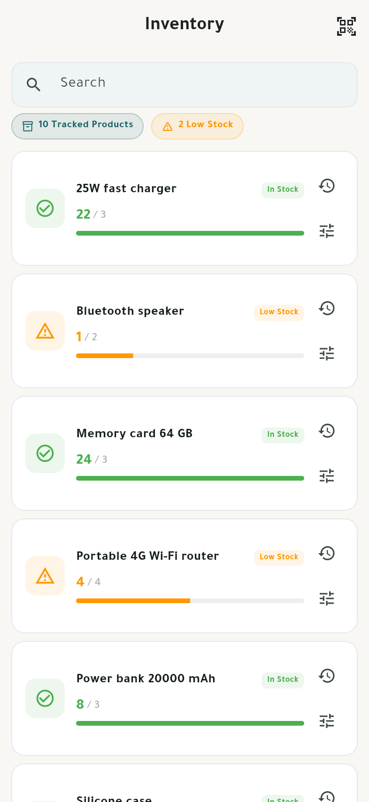 | 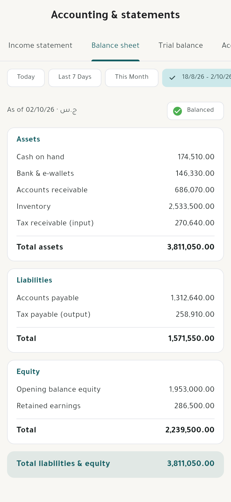 |

**Arabic (RTL)**

| الرئيسية | البيع السريع | فاتورة PDF | الميزانية العمومية |
|:--:|:--:|:--:|:--:|
|  |  | 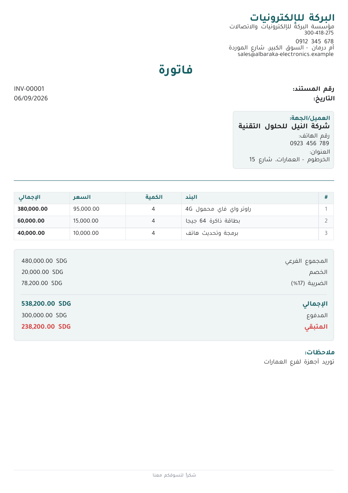 | 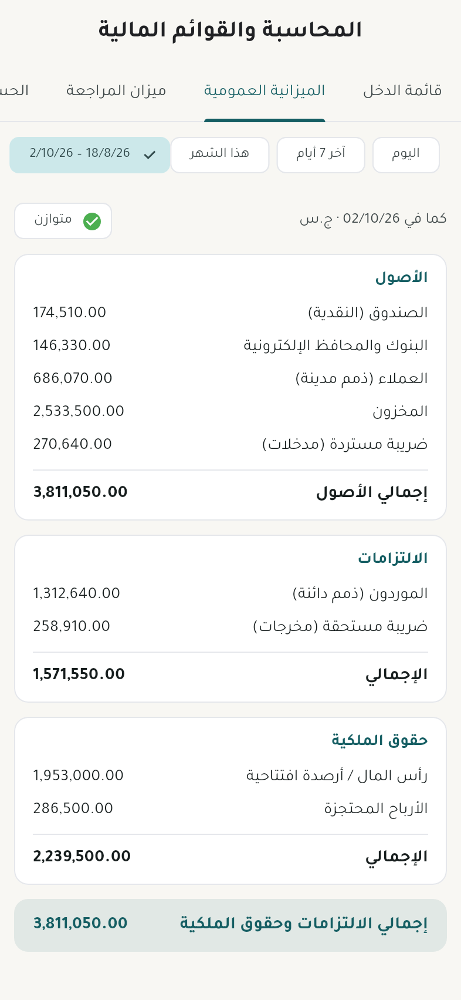 |

**Tablet**: the cart sits beside the product grid.

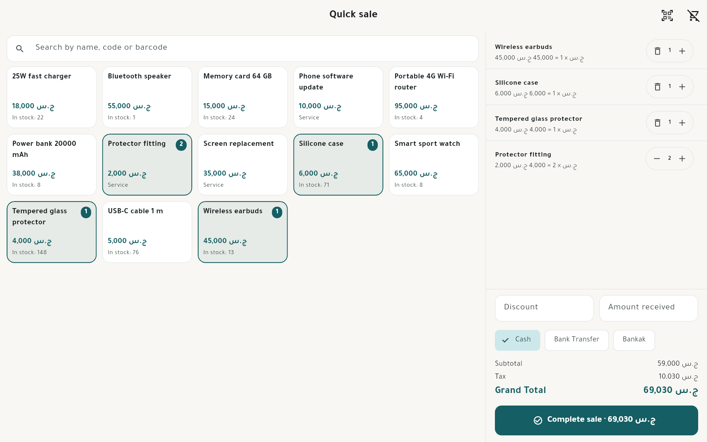

## Features

**Selling**
- **Quick sale (POS):** one-tap product grid, search by name, code or
  barcode, camera barcode scanning, a stock-aware cart, discount, payment
  method, amount received and change. A sale creates a paid invoice and a
  receipt and deducts stock in a single transaction, then prints an 80 mm
  receipt.
- **Documents:** invoices, quotations (convertible to invoices), purchase
  orders, payment receipts, expense vouchers and custom documents.
- **Payments:** draft, issued, partially paid, paid and cancelled statuses,
  partial payments with linked receipts, and a payment history per document.

**Customers, products and stock**
- Customers and suppliers, each with an account page (invoiced, paid,
  outstanding).
- Products and services with sale and purchase prices, barcodes and units.
- Inventory with automatic stock movements, minimum levels and low-stock
  alerts, adjustments with a reason, and movement history.

**Reports and accounting**
- Sales, purchases, payments, customer, supplier, inventory and product
  reports.
- Income statement, balance sheet, trial balance and account ledger, derived
  from your documents (IAS 2 weighted-average cost of sales, separate input
  and output tax).

**Documents and PDF**
- A4, A5 and 80 mm thermal PDFs with correct Arabic text shaping, shareable
  from the document screen.
- PDF design settings: three templates, accent colour, logo shape, text
  size, per-section toggles, footer text and a live preview.

**App**
- Tax-inclusive or tax-exclusive pricing, multiple currencies and
  configurable payment methods.
- Light, dark or system theme. Phone layout, and a navigation rail on tablets.
- Backup and restore to a `.waraq` file.

## Free and Pro

- **You can use Waraqatak without activating anything.** Every new install
  starts with a 14-day period in which all features are unlocked.
- **Most of the app is free, permanently:** invoices, quotations, vouchers,
  custom documents, customers, products, barcode scanning, quick sale,
  basic reports, PDF design, and backup and restore.
- **Pro adds** purchase orders and suppliers, inventory and stock tracking,
  and advanced reports including the accounting statements.
- **Activation** is handled inside the app under Settings → License, using
  the app's licensing system. There are no in-app purchases.

The exact split is documented in [docs/free-vs-pro.md](docs/free-vs-pro.md)
and enforced from a single place, `lib/services/feature_access.dart`.

## Engineering decisions

- **Offline-first.** Every feature works without a network. The only network
  call is licence activation, and the app does not need it to run.
- **Local persistence you can trust.** SQLite with explicit, versioned
  migrations that preserve user data. Multi-step operations, such as a sale
  that creates an invoice, a receipt and stock movements, run in one
  database transaction so a failure can't leave half a sale behind.
- **Derived accounting.** The ledger is computed from issued documents and
  never written to the database, so reports can't drift from the source
  documents. Drafts and cancelled documents are excluded.
- **Arabic PDFs.** PDFs are built with an embedded Arabic font and shared
  builders, so Arabic text shapes correctly across A4, A5 and thermal
  layouts.
- **RTL as a requirement.** Arabic and English are both supported as
  first-class languages, with RTL layouts preserved.
- **Barcode workflows.** Camera scanning is available in Quick sale and when
  adding invoice items; products store their own barcode.
- **Backup and restore.** Data exports to a `.waraq` file that is validated
  before it is imported. The app warns that backups are not encrypted.
- **Licensing.** Activation keys are checked on the device for the right
  app and for expiry before activation. Entitlement is then stored in
  secure storage and evaluated locally.
- **Play policy guard.** `tool/check_play_compliance.sh` runs in CI to keep
  purchase wording and unapproved links out of the app
  ([details](docs/play-compliance.md)).

## Technical overview

| Area | Used |
|---|---|
| Framework | Flutter (Dart), Android |
| Data | SQLite via `sqflite`, `shared_preferences` |
| Secrets | `flutter_secure_storage` (licence and trial state) |
| PDF and printing | `pdf`, `printing` |
| Sharing and files | `share_plus`, `file_picker`, `path_provider` |
| Barcode | `mobile_scanner` |
| Localization | `flutter_localizations`, `intl`, Tajawal font |
| Licensing client | local package [`elmahdi_pay_flutter`](packages/elmahdi_pay_flutter) |
| Tests | `flutter_test`, `sqflite_common_ffi` (real SQLite) |
| CI | GitHub Actions: analyze, test, debug and arm64 APK, signed AAB |

## Project structure

```
lib/
  core/            shared infrastructure (theme mode, constants)
  database/        SQLite helper and migrations
  localization/    Arabic / English strings
  models/          domain models
  screens/         UI (reports/ holds reports and accounting screens)
  services/        business logic
    accounting/    derived double-entry ledger and statements
    pdf/           PDF builders
  utils/           settings and helpers
  widgets/         reusable UI
packages/          elmahdi_pay_flutter, the licensing client
test/              unit, widget and real-SQLite tests
tool/              Play compliance guard
docs/              architecture, database, compliance, feature tour
```

More in [docs/architecture.md](docs/architecture.md) and
[docs/database.md](docs/database.md).

## Getting started

Requires the Flutter SDK (CI uses 3.41.9, stable) and the Android SDK.

```bash
flutter pub get
flutter analyze
flutter test
bash tool/check_play_compliance.sh
flutter run
```

Database tests run against real SQLite through `sqflite_common_ffi`, which
needs the system `libsqlite3`. To regenerate the screenshots, see
[docs/showcase/README.md](docs/showcase/README.md).

Release builds need a signing keystore. CI uses `ALLOW_DEBUG_SIGNING=true`
for test builds only. Development workflow: [docs/development.md](docs/development.md).

## Documentation

| | |
|---|---|
| [Feature tour](docs/showcase/README.md) | Screenshots with explanations, Arabic and English |
| [Free vs Pro](docs/free-vs-pro.md) | Feature matrix and licensing model |
| [Architecture](docs/architecture.md) · [Database](docs/database.md) | How the code and data are organised |
| [Play compliance](docs/play-compliance.md) | Store-policy decisions and the CI guard |
| [Testing](docs/testing.md) · [Roadmap](docs/roadmap.md) | How it is tested and what is planned |

## Privacy and support

- Your business data stays on your device. See the
  [privacy policy](https://almhdy24.com/products/waraqatak/privacy.html),
  [terms](https://almhdy24.com/products/waraqatak/terms.html) and
  [data deletion](https://almhdy24.com/products/waraqatak/delete.html).
- Support: [support@almhdy24.com](mailto:support@almhdy24.com) ·
  [almhdy24.com](https://almhdy24.com)
- Bugs and ideas: [open an issue](https://github.com/almhdy24/waraqatak/issues).

## License

No open-source licence file has been published in this repository, so
default copyright applies: please contact the author before reusing the
code. The bundled Tajawal font is distributed under the SIL Open Font
License 1.1 (`assets/fonts/OFL.txt`).

Developed by Elmahdi Abdallh (Elmahdi Dev).
