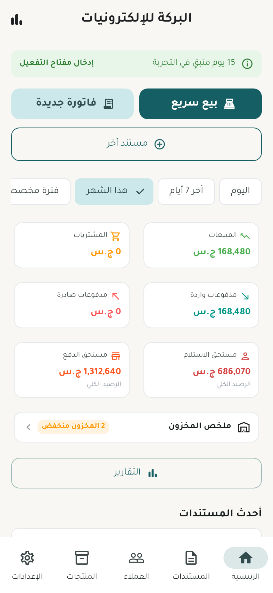
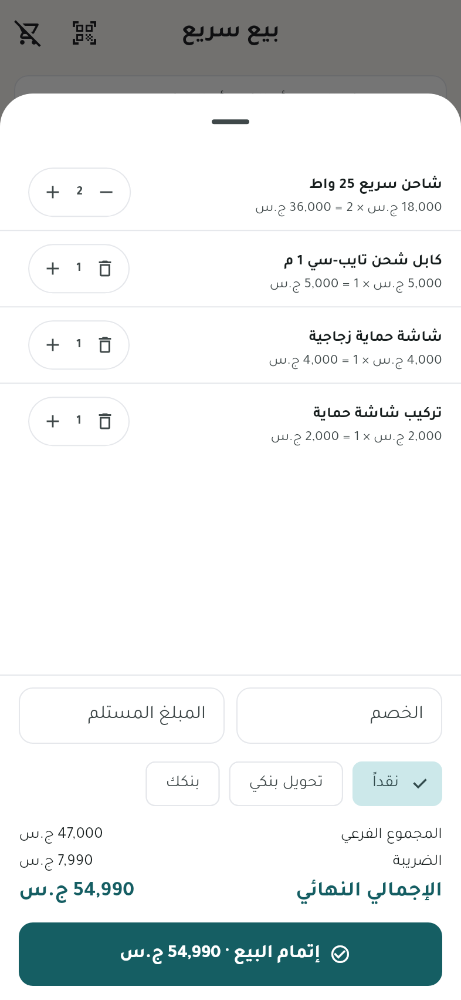

# ورقتك | Waraqatak

Offline-first business app for small shops and service businesses, built
with Flutter. Arabic (RTL) and English. All data stays on the device in
SQLite.

[Google Play](https://play.google.com/store/apps/details?id=com.elmahdi.waraqatak) ·
[Feature tour with screenshots](docs/showcase/README.md)

| Home | Quick sale | Balance sheet | Invoice PDF |
|---|---|---|---|
|  |  |  |  |

## Features

**Selling**
- Quick sale (POS): a one-tap product grid, search, camera barcode scanning,
  stock-aware cart, discount, payment method, amount received and change.
  Each sale creates a paid invoice and receipt and deducts stock in one
  transaction, then prints an 80 mm receipt.
- Invoices, quotations (convert to invoice), purchase orders, payment
  receipts, expense vouchers and custom documents.
- Statuses (draft, issued, partially paid, paid, cancelled), partial
  payments with linked receipts, and per-document payment history.

**Customers, products & stock**
- Customers and suppliers with an account page each (invoiced, paid,
  outstanding).
- Products and services with sale and purchase prices, barcodes and units.
- Inventory: automatic stock movements, minimum levels and alerts,
  adjustments with a reason, and movement history.

**Accounting & reports**
- Double-entry ledger derived from documents: chart of accounts, IAS 2
  weighted-average cost of sales, and separate input and output tax.
- Income statement, balance sheet, trial balance, and an account ledger
  with the full journal entry behind each line.
- Sales, purchases, payments, customer, supplier, inventory and product
  reports.

**Documents & PDF**
- A4, A5 and 80 mm thermal PDFs with correct Arabic shaping.
- PDF design settings: 3 templates, accent colour, logo shape, text size,
  a toggle for each section, footer text, and a live preview.

**App**
- Taxes (inclusive or exclusive), multiple currencies, and configurable
  payment methods.
- Light, dark or system theme. Phone and tablet layouts (navigation rail).
- Backup and restore (`.waraq`).
- 14-day full trial, then Free + Pro features via an activation key (see
  [docs/free-vs-pro.md](docs/free-vs-pro.md)). There are no in-app
  purchases.

## Structure

```
lib/
  core/            shared infrastructure (theme mode, constants)
  database/        SQLite (database_helper.dart) and migrations
  localization/    Arabic / English strings
  models/          domain models
  screens/         UI (reports/ holds the reports and accounting screens)
  services/        business logic
    accounting/    derived double-entry ledger and statements
    pdf/           PDF builders
  utils/           settings and helpers
  widgets/         reusable UI
test/              unit, widget and real-SQLite (ffi) tests
test/showcase/     screenshot harness and demo store (opt-in)
tool/              Play compliance guard
docs/              architecture, compliance, feature tour
```

## Development

Requires the Flutter SDK.

    flutter pub get
    flutter analyze
    flutter test
    bash tool/check_play_compliance.sh
    flutter run

Database tests run against real SQLite through `sqflite_common_ffi`, which
needs the system `libsqlite3`. To regenerate the screenshots, see
[docs/showcase/README.md](docs/showcase/README.md).

Release builds need a signing keystore. CI uses `ALLOW_DEBUG_SIGNING=true`
for test builds only.

## Database

SQLite: `lib/database/database_helper.dart`.

Database changes must use explicit migrations and preserve existing user
data. Accounting reports are computed from documents and never write to
the database.

## Agent

Agent instructions: `AGENTS.md`. The source code is the source of truth.
