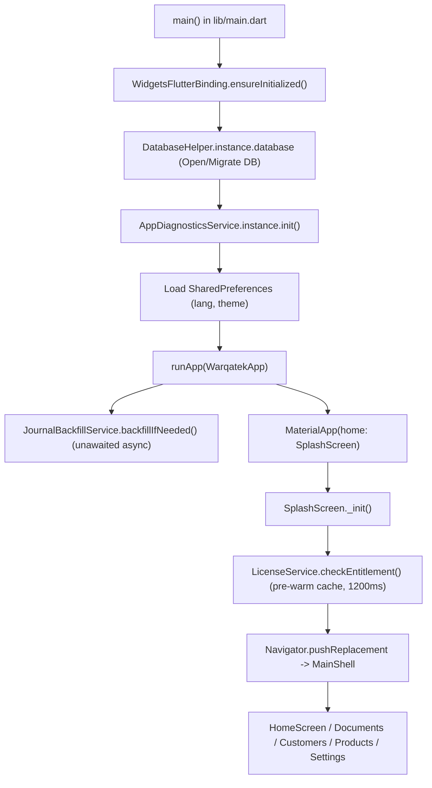

# Architecture Audit: Multi-User & Permissions Readiness

**Target Project:** Waraqatak (ورقتك) Flutter Application (`warqatek`)  
**Version:** 1.1.5+22  
**Audit Scope:** Read-Only inspection for Phase 1 (Local multi-user & role-based permissions on a single device) and Phase 2 (Multi-device cloud synchronization readiness).  
**Date:** November 2026  

---

## 1. Database Layer

### 1.1 Database Engine & Package
* **Package:** `sqflite: '>=2.3.0 <2.4.0'` with `path: ^1.8.3` (see [pubspec.yaml](file:///data/data/com.termux/files/home/projects/waraqatak/pubspec.yaml#L20-L21)).
* **Test Engine:** `sqflite_common_ffi: ^2.4.0+3` for host SQLite execution (see [pubspec.yaml](file:///data/data/com.termux/files/home/projects/waraqatak/pubspec.yaml#L77)).
* **No Drift / ObjectBox / Hive:** Direct raw SQL execution and query building through `Database` / `DatabaseExecutor` handles.

### 1.2 Database File Location & Configuration
* **Database Filename:** `warqatek_free.db` located at `join(await getDatabasesPath(), 'warqatek_free.db')` (see [lib/database/database_helper.dart#L48](file:///data/data/com.termux/files/home/projects/waraqatak/lib/database/database_helper.dart#L48)).
* **Foreign Keys Configuration:** Enforced on open: `onConfigure: (db) async => db.execute('PRAGMA foreign_keys = ON')` (see [lib/database/database_helper.dart#L52](file:///data/data/com.termux/files/home/projects/waraqatak/lib/database/database_helper.dart#L52)).
* **Current Schema Version:** `static const int dbVersion = 28;` (see [lib/database/database_helper.dart#L38](file:///data/data/com.termux/files/home/projects/waraqatak/lib/database/database_helper.dart#L38)).

### 1.3 Migration Architecture & Ordering
* **Mechanism:** Sequential conditional blocks in `_upgradeTables(Database db, int oldVersion, int newVersion)` (see [lib/database/database_helper.dart#L693-L1516](file:///data/data/com.termux/files/home/projects/waraqatak/lib/database/database_helper.dart#L693-L1516)).
  * Incremental checks: `if (oldVersion < 2)`, `if (oldVersion < 3)`, ..., up to `if (oldVersion < 28 && newVersion >= 28)`.
  * Migrations run within the `openDatabase` callback before `database` Future resolves.
  * Helper functions dynamically verify table and column existence (`columnExists(table, column)`, `tableExists(table)`) before `ALTER TABLE ADD COLUMN` or indexing.
* **Fresh Installs:** `_createTables(Database db, int version)` (see [lib/database/database_helper.dart#L221-L680](file:///data/data/com.termux/files/home/projects/waraqatak/lib/database/database_helper.dart#L221-L680)) executes the full, latest DDL schema at once.
* **In-Flight Migrations / Branch Collision Check:**
  * Checked all local and remote branches (`feat/accounting-backbone`, `feat/reference-currency-pricing`, `feat/quotation-multipliers`, `remediation/full-audit`, `integration/ref-currency`).
  * `main` and `feat/quotation-multipliers` are currently at `dbVersion = 28`.
  * No unmerged branch has bumped `dbVersion` past 28.
  * **Next available migration version:** `dbVersion = 29`.

### 1.4 Comprehensive Table Catalog (21 Tables)

| # | Table Name | Primary Key | Key Foreign Keys | Unique / Key Indexes |
|---|---|---|---|---|
| 1 | `payment_methods` | `id` (INTEGER AUTOINCREMENT) | None | `key` UNIQUE |
| 2 | `tax_profiles` | `id` (INTEGER AUTOINCREMENT) | None | None |
| 3 | `businesses` | `id` (INTEGER AUTOINCREMENT) | `default_tax_profile_id` (logical) | None |
| 4 | `contacts` | `id` (INTEGER AUTOINCREMENT) | None | None |
| 5 | `products` | `id` (INTEGER AUTOINCREMENT) | `tax_profile_id` (logical) | `idx_products_barcode_unique` (partial UNIQUE), `idx_products_name`, `idx_products_category`, `idx_products_price_currency` |
| 6 | `product_units` | `id` (INTEGER AUTOINCREMENT) | `product_id -> products(id) ON DELETE CASCADE` | `idx_product_units_product` |
| 7 | `exchange_rates` | `code` (TEXT) | None | PK on `code` |
| 8 | `stock_movements` | `id` (INTEGER AUTOINCREMENT) | `product_id -> products(id)`, `reference_document_id -> documents(id) ON DELETE SET NULL` | `idx_stock_movements_product`, `idx_stock_movements_cost`, `idx_stock_movements_ref_doc`, `idx_stock_movements_date` |
| 9 | `documents` | `id` (INTEGER AUTOINCREMENT) | `contact_id -> contacts(id)`, `related_document_id -> documents(id)` | `idx_documents_type_docnum_unique` (UNIQUE), `idx_documents_contact`, `idx_documents_related`, `idx_documents_type_status_date` |
| 10 | `document_items` | `id` (INTEGER AUTOINCREMENT) | `document_id -> documents(id) ON DELETE CASCADE`, `product_id -> products(id)` | `idx_document_items_doc`, `idx_document_items_prod` |
| 11 | `document_counters` | `type` (TEXT) | None | PK on `type` |
| 12 | `document_payments` | `id` (INTEGER AUTOINCREMENT) | `document_id -> documents(id) ON DELETE CASCADE`, `receipt_document_id -> documents(id)` | `idx_document_payments_doc`, `idx_document_payments_receipt`, `idx_document_payments_date`, `idx_document_payments_origin` |
| 13 | `audit_log` | `id` (INTEGER AUTOINCREMENT) | None | `idx_audit_log_action`, `idx_audit_log_timestamp` |
| 14 | `cached_notifications` | `id` (INTEGER AUTOINCREMENT) | None | `server_id` UNIQUE, `idx_cached_notif_server`, `idx_cached_notif_read` |
| 15 | `diagnostic_reports` | `id` (INTEGER AUTOINCREMENT) | None | `report_uuid` UNIQUE, `idx_diag_uuid`, `idx_diag_created` |
| 16 | `stocktake_sessions` | `id` (INTEGER AUTOINCREMENT) | None | `session_number` UNIQUE, `idx_stocktake_sessions_status` |
| 17 | `stocktake_items` | `id` (INTEGER AUTOINCREMENT) | `session_id -> stocktake_sessions(id) ON DELETE CASCADE`, `product_id -> products(id)` | `idx_stocktake_items_session`, `idx_stocktake_items_product` |
| 18 | `accounts` | `code` (TEXT) | None | PK on `code` |
| 19 | `journal_entries` | `id` (INTEGER AUTOINCREMENT) | `reverses_entry_id -> journal_entries(id)` | `entry_no` UNIQUE, `idx_journal_entries_date`, `idx_journal_entries_source`, `idx_journal_entries_origin` |
| 20 | `journal_lines` | `id` (INTEGER AUTOINCREMENT) | `entry_id -> journal_entries(id) ON DELETE CASCADE`, `account_code -> accounts(code)`, `product_id -> products(id) ON DELETE SET NULL`, `contact_id -> contacts(id) ON DELETE SET NULL` | `idx_journal_lines_entry`, `idx_journal_lines_account`, `idx_journal_lines_product`, `idx_journal_lines_contact` |
| 21 | `app_settings` | `key` (TEXT) | None | PK on `key` |

---

## 2. Existing Audit & Activity Log Table

### 2.1 Table Structure
Defined at [lib/database/database_helper.dart#L507-L515](file:///data/data/com.termux/files/home/projects/waraqatak/lib/database/database_helper.dart#L507-L515):
```sql
CREATE TABLE audit_log (
  id INTEGER PRIMARY KEY AUTOINCREMENT,
  action TEXT NOT NULL,
  entity_type TEXT,
  entity_id INTEGER,
  details TEXT,
  timestamp TEXT NOT NULL
);
CREATE INDEX idx_audit_log_action ON audit_log(action);
CREATE INDEX idx_audit_log_timestamp ON audit_log(timestamp);
```

### 2.2 Writers to `audit_log`
* `DatabaseHelper.logAuditEvent` helper ([lib/database/database_helper.dart#L7365-L7385](file:///data/data/com.termux/files/home/projects/waraqatak/lib/database/database_helper.dart#L7365-L7385)), called by:
  * `DatabaseHelper.adjustStock` (action: `'stock_adjusted'`) ([lib/database/database_helper.dart#L3505](file:///data/data/com.termux/files/home/projects/waraqatak/lib/database/database_helper.dart#L3505))
* `DatabaseHelper.cancelDocument` (when cancelling a paid document with refund details, action: `'document_refund_status'`) ([lib/database/database_helper.dart#L5530](file:///data/data/com.termux/files/home/projects/waraqatak/lib/database/database_helper.dart#L5530))
* `DatabaseHelper.updateDocumentRefundStatus` (action: `'refund_status_changed'`) ([lib/database/database_helper.dart#L5563](file:///data/data/com.termux/files/home/projects/waraqatak/lib/database/database_helper.dart#L5563))
* `DatabaseHelper.finalizeStocktakeSession` (action: `'stocktake_adjustment'` at L7893 and `'stocktake_finalized'` at L8106) ([lib/database/database_helper.dart#L7893, L8106](file:///data/data/com.termux/files/home/projects/waraqatak/lib/database/database_helper.dart#L7893))
* `DatabaseHelper.cancelStocktakeSession` (action: `'stocktake_cancelled'`) ([lib/database/database_helper.dart#L8149](file:///data/data/com.termux/files/home/projects/waraqatak/lib/database/database_helper.dart#L8149))
* `InventoryCostingService` (action: `'costing_adjustment'`) ([lib/services/inventory_costing_service.dart#L288](file:///data/data/com.termux/files/home/projects/waraqatak/lib/services/inventory_costing_service.dart#L288))
* `BulkPricingService` (action: `'bulk_price_adjustment'`) ([lib/services/bulk_pricing_service.dart#L291](file:///data/data/com.termux/files/home/projects/waraqatak/lib/services/bulk_pricing_service.dart#L291))
* `CsvService` (action: `'csv_import'`) ([lib/services/csv_service.dart#L1054](file:///data/data/com.termux/files/home/projects/waraqatak/lib/services/csv_service.dart#L1054))
* `DatabaseRepairService` (repair actions) ([lib/services/database_repair_service.dart#L1417, L1463](file:///data/data/com.termux/files/home/projects/waraqatak/lib/services/database_repair_service.dart#L1417))
* `ReferencePricingDao` (action: `'exchange_rate_updated'`) ([lib/database/reference_pricing_dao.dart#L637](file:///data/data/com.termux/files/home/projects/waraqatak/lib/database/reference_pricing_dao.dart#L637))
* Migrations:
  * Migration v17 costing backfill repair (`v17_costing_repair_start` at L2375, `v17_costing_repair_complete` at L2575)
  * Migration v27 barcode dedup (`v27_barcode_dedup` at L1452) and docnum dedup (`v27_docnum_dedup` at L1496)

### 2.3 Mutations on `audit_log` (UPDATE / DELETE)
* **UPDATE:** Zero occurrences. `audit_log` is treated as append-only during normal runtime.
* **DELETE:** Exactly **one place** deletes from `audit_log`:
  * [lib/services/backup_service.dart#L624](file:///data/data/com.termux/files/home/projects/waraqatak/lib/services/backup_service.dart#L624): `await txn.delete('audit_log');` during full database restoration from a `.waraq` backup file.

### 2.4 Gaps for Multi-User
* **No Actor Column:** The table has no `user_id`, `actor_name`, or `device_id` column.
* **No Document Creation/Edit Audit:** Regular invoice creations, edits, and standard payments are NOT logged in `audit_log` (they only generate journal lines and document rows).

---

## 3. Architecture Layering & Direct UI Database Calls

### 3.1 State Management & Architecture Pattern
* **No State Framework:** No Bloc, Riverpod, Redux, or `provider` package is used.
* **UI State:** Standard Flutter `StatefulWidget` / `setState()` with async lifecycle loading.
* **Scoped State:** Custom `InheritedWidget`s:
  * `LanguageProvider` ([lib/localization/app_localizations.dart#L4](file:///data/data/com.termux/files/home/projects/waraqatak/lib/localization/app_localizations.dart#L4))
  * `ThemeModeScope` ([lib/core/theme_mode_scope.dart#L4](file:///data/data/com.termux/files/home/projects/waraqatak/lib/core/theme_mode_scope.dart#L4))
* **Screen Refresh Signaling:** Integer tokens incremented in `MainShell` and passed to tabs (`refreshToken`).

### 3.2 Where Business Logic Lives
* **Application Orchestration Services (`lib/services/`):**
  * `DocumentService`: Price calculation, invoice validation, payment dispatching.
  * `PostingService` / `JournalWriter`: Double-entry accounting enforcement (INV-14, INV-15).
  * `StockLedger`: Authoritative single stock writer and moving average cost mutation (INV-16).
  * `LicenseService` / `FeatureAccess`: Pro entitlement gating.
* **Database Monolith (`lib/database/database_helper.dart`):**
  * Spans **8,201 lines**. Holds core domain logic including invoice status computation, document stock delta resolution, period locking assertions (INV-17), and payment-receipt generation.

### 3.3 Direct Database Access from UI (Bypassing Services)
A total of **40 UI files** (36 screens + 4 widgets) directly call `DatabaseHelper.instance` or access raw `Database` via `DatabaseHelper.instance.database`.

#### High-Risk UI Direct Mutations (Bypassing Services)
1. [lib/screens/contact_form_screen.dart#L118-L120](file:///data/data/com.termux/files/home/projects/waraqatak/lib/screens/contact_form_screen.dart#L118-L120): `insertContact`, `updateContact`
2. [lib/screens/customers_screen.dart#L111, L143](file:///data/data/com.termux/files/home/projects/waraqatak/lib/screens/customers_screen.dart#L111): `setContactActive`, `deleteContact`
3. [lib/screens/product_form_screen.dart#L533, L583](file:///data/data/com.termux/files/home/projects/waraqatak/lib/screens/product_form_screen.dart#L533): `saveProductWithUnits`, `deleteProduct`
4. [lib/screens/document_detail_screen.dart#L207](file:///data/data/com.termux/files/home/projects/waraqatak/lib/screens/document_detail_screen.dart#L207): `deleteDocument`
5. [lib/screens/business_setup_screen.dart#L186-L188](file:///data/data/com.termux/files/home/projects/waraqatak/lib/screens/business_setup_screen.dart#L186-L188): `insertBusiness`, `updateBusiness`
6. [lib/screens/settings_screen.dart#L243](file:///data/data/com.termux/files/home/projects/waraqatak/lib/screens/settings_screen.dart#L243): `updateBusiness` (wholesale toggle)
7. [lib/screens/financial_settings_screen.dart#L131, L566, L587](file:///data/data/com.termux/files/home/projects/waraqatak/lib/screens/financial_settings_screen.dart#L131): `updateBusiness`, `setBooksClosedThrough`
8. [lib/screens/payment_methods_screen.dart#L35, L43, L119, L195, L257](file:///data/data/com.termux/files/home/projects/waraqatak/lib/screens/payment_methods_screen.dart#L35): `setPaymentMethodEnabled`, `setPaymentMethodDefault`, `insertCustomPaymentMethod`, `updatePaymentMethodLabel`, `deletePaymentMethod`
9. [lib/screens/tax_profiles_screen.dart#L164-L166, L202](file:///data/data/com.termux/files/home/projects/waraqatak/lib/screens/tax_profiles_screen.dart#L164-L166): `insertTaxProfile`, `updateTaxProfile`, `deleteTaxProfile`
10. [lib/screens/stocktake/stocktake_screen.dart#L65](file:///data/data/com.termux/files/home/projects/waraqatak/lib/screens/stocktake/stocktake_screen.dart#L65): extracts raw `final db = await DatabaseHelper.instance.database` and performs raw queries
11. [lib/screens/bulk_pricing_screen.dart#L78](file:///data/data/com.termux/files/home/projects/waraqatak/lib/screens/bulk_pricing_screen.dart#L78): extracts raw `final db = await DatabaseHelper.instance.database`
12. [lib/screens/reports/advanced_inventory_analytics_screen.dart#L70](file:///data/data/com.termux/files/home/projects/waraqatak/lib/screens/reports/advanced_inventory_analytics_screen.dart#L70): extracts raw `final db = await DatabaseHelper.instance.database`
13. [lib/screens/database_diagnostic_screen.dart#L1569, L2432](file:///data/data/com.termux/files/home/projects/waraqatak/lib/screens/database_diagnostic_screen.dart#L1569): extracts raw `await DatabaseHelper.instance.database`

#### Read-Only Direct UI Callers (Bypassing Services)
* `audit_history_screen.dart`: `getAuditEvents`, `getFirstBusiness`, `getDocumentById`
* `custom_document_screen.dart`: `getFirstBusiness`
* `customer_detail_screen.dart`: `getContactById`, `getFirstBusiness`
* `documents_screen.dart`: `getAllDocuments`, `getContactById`
* `edit_document_screen.dart`: `getProductUnits`, `getFirstBusiness`
* `exchange_rates_screen.dart`: `getFirstBusiness`
* `home_screen.dart`: `getFirstBusiness`, dashboard queries
* `inventory_screen.dart`: `searchProducts`, `getAllProducts`, `searchActiveProducts`
* `invoice_screen.dart`: `getFirstBusiness`, `getTaxProfiles`, `getProductById`
* `purchase_screen.dart`: `getFirstBusiness`, `getTaxProfiles`, `getProductById`
* `quick_sale_screen.dart`: `getFirstBusiness`, `getEnabledPaymentMethods`
* `quotation_screen.dart`: `getFirstBusiness`, `getTaxProfiles`, `getProductById`
* `reports/` (`sales_report_screen.dart`, `purchases_report_screen.dart`, `inventory_report_screen.dart`, `product_report_screen.dart`, `customer_report_screen.dart`, `supplier_report_screen.dart`, `payments_report_screen.dart`): all call `DatabaseHelper.instance` directly.
* `stock_movements_screen.dart`: `getAllProducts`, `getFirstBusiness`, `getDocumentById`
* `voucher_screen.dart`: `getFirstBusiness`, `getEnabledPaymentMethods`
* `contact_autocomplete_field.dart`: `searchContacts`
* `product_autocomplete_field.dart`: `searchActiveProducts`
* `document_item_form.dart`: `getProductById`, `getProductUnits`, `getProductByBarcode`
* `customer_statement_dialog.dart`: `getFirstBusiness`

---

## 4. Money & Accounting Flows

Every financial flow in the system has been mapped below:

### 4.1 Sales Invoice Flow (Create / Edit / Cancel)
* **Create:** `DocumentService.createDocument` ([lib/services/document_service.dart#L72](file:///data/data/com.termux/files/home/projects/waraqatak/lib/services/document_service.dart#L72)) -> `DatabaseHelper.insertDocumentWithItems` ([lib/database/database_helper.dart#L3533](file:///data/data/com.termux/files/home/projects/waraqatak/lib/database/database_helper.dart#L3533)).
  * *Tables touched:* `documents`, `document_items`, `document_counters`, `stock_movements`, `products`, `document_payments` (if immediate pay), `journal_entries`, `journal_lines`.
  * *Who did this field:* **None**.
* **Edit:** `DocumentService.updateDocument` ([lib/services/document_service.dart#L291](file:///data/data/com.termux/files/home/projects/waraqatak/lib/services/document_service.dart#L291)) -> `DatabaseHelper.updateDocumentWithItems` ([lib/database/database_helper.dart#L4158](file:///data/data/com.termux/files/home/projects/waraqatak/lib/database/database_helper.dart#L4158)).
  * *Tables touched:* `documents`, `document_items` (re-inserted), `stock_movements`, `products`, `journal_entries` (reversal posted + replacement posted), `journal_lines`.
  * *Who did this field:* **None**.
* **Cancel / Delete:**
  * Cancel (Unpaid & Paid): `DocumentService.cancelDocument` ([lib/services/document_service.dart#L573](file:///data/data/com.termux/files/home/projects/waraqatak/lib/services/document_service.dart#L573)) -> `DatabaseHelper.cancelDocument` ([lib/database/database_helper.dart#L5222-L5546](file:///data/data/com.termux/files/home/projects/waraqatak/lib/database/database_helper.dart#L5222-L5546)). Handles stock reversal, journal reversal, and (if paid, prompted via `CancelPaidDocumentDialog`) refund status tracking.
  * Delete (Unpaid/Draft only): `DatabaseHelper.deleteDocument` ([lib/database/database_helper.dart#L4921](file:///data/data/com.termux/files/home/projects/waraqatak/lib/database/database_helper.dart#L4921)).
  * *Tables touched:* `documents`, `stock_movements`, `products`, `audit_log`, `journal_entries`, `journal_lines`.
  * *Who did this field:* **None** (audit_log logs the action string and refund details, but no user identifier).

### 4.2 Payments
* **Method:** `DocumentService.recordPayment` ([lib/services/document_service.dart#L522](file:///data/data/com.termux/files/home/projects/waraqatak/lib/services/document_service.dart#L522)) -> `DatabaseHelper.recordPaymentWithReceipt` ([lib/database/database_helper.dart#L5992](file:///data/data/com.termux/files/home/projects/waraqatak/lib/database/database_helper.dart#L5992)) / `_recordPaymentTxn` ([lib/database/database_helper.dart#L6012](file:///data/data/com.termux/files/home/projects/waraqatak/lib/database/database_helper.dart#L6012)).
* *Tables touched:* `document_payments`, `documents` (updates paid/remaining, inserts auto-generated `payment_receipt` document), `document_counters`, `journal_entries`, `journal_lines`.
* *Who did this field:* **None**.

### 4.3 Refunds
* **Method:** `DocumentService.updateDocumentRefundStatus` ([lib/services/document_service.dart#L591](file:///data/data/com.termux/files/home/projects/waraqatak/lib/services/document_service.dart#L591)) -> `DatabaseHelper.updateDocumentRefundStatus` ([lib/database/database_helper.dart#L5549](file:///data/data/com.termux/files/home/projects/waraqatak/lib/database/database_helper.dart#L5549)).
* *Tables touched:* `audit_log` (records JSON details of refund change).
* *Who did this field:* **None**.

### 4.4 Purchases
* **Method:** Same pipeline as invoices (`DocumentService.createDocument` with `document.type = 'purchase'`).
* *Tables touched:* `documents`, `document_items`, `document_counters`, `stock_movements`, `products` (updates moving average cost), `journal_entries`, `journal_lines`.
* *Who did this field:* **None**.

### 4.5 Expenses & Financial Vouchers
* **Method:** `DocumentService.createDocument` with `type: 'expense_voucher'` or `type: 'payment_receipt'` (initiated from [lib/screens/voucher_screen.dart#L241](file:///data/data/com.termux/files/home/projects/waraqatak/lib/screens/voucher_screen.dart#L241)).
* *Tables touched:* `documents`, `document_counters`, `journal_entries` (Dr Expense 5100 / Cr Cash 1110), `journal_lines`.
* *Who did this field:* **None**.

### 4.6 Stock Adjustments
* **Method:** `InventoryService.adjust` ([lib/services/inventory_service.dart#L26](file:///data/data/com.termux/files/home/projects/waraqatak/lib/services/inventory_service.dart#L26)) -> `DatabaseHelper.adjustStock` ([lib/database/database_helper.dart#L3486](file:///data/data/com.termux/files/home/projects/waraqatak/lib/database/database_helper.dart#L3486)) -> `StockLedger.record` -> `JournalWriter.write`.
* *Tables touched:* `stock_movements`, `products`, `audit_log`, `journal_entries`, `journal_lines`.
* *Who did this field:* **None**.

### 4.7 Customers & Suppliers
* **Create/Update:** Direct UI calls in [lib/screens/contact_form_screen.dart#L118-L120](file:///data/data/com.termux/files/home/projects/waraqatak/lib/screens/contact_form_screen.dart#L118-L120) -> `DatabaseHelper.insertContact` / `updateContact`.
* **Delete:** Direct UI calls in [lib/screens/customers_screen.dart#L111, L143](file:///data/data/com.termux/files/home/projects/waraqatak/lib/screens/customers_screen.dart#L111) -> `DatabaseHelper.deleteContact` (logs to `audit_log`) or `setContactActive(false)`.
* *Tables touched:* `contacts`, `audit_log`.
* *Who did this field:* **None**.

---

## 5. Sensitive Data Exposure Points

The following surfaces expose purchase costs, gross margins, profits, wholesale pricing, or complete financial totals:

### 5.1 UI Screens & Reports
1. **[lib/screens/home_screen.dart](file:///data/data/com.termux/files/home/projects/waraqatak/lib/screens/home_screen.dart):** Displays sales totals, period revenue cards, total receivables.
2. **[lib/screens/reports/accounting_screen.dart](file:///data/data/com.termux/files/home/projects/waraqatak/lib/screens/reports/accounting_screen.dart):** Exposes full **Income Statement** (Sales, COGS, Gross Profit, Operating Expenses, Net Income), **Balance Sheet**, **Trial Balance**, and **General Ledger**.
3. **[lib/screens/reports/sales_report_screen.dart](file:///data/data/com.termux/files/home/projects/waraqatak/lib/screens/reports/sales_report_screen.dart):** Exposes total revenue, total cost of goods, gross profit, and profit margin percentage.
4. **[lib/screens/reports/product_report_screen.dart](file:///data/data/com.termux/files/home/projects/waraqatak/lib/screens/reports/product_report_screen.dart):** Exposes product net profit, unit cost, and volume margins.
5. **[lib/screens/reports/inventory_report_screen.dart](file:///data/data/com.termux/files/home/projects/waraqatak/lib/screens/reports/inventory_report_screen.dart):** Exposes inventory valuation at purchase cost vs sale price, and expected aggregate profit.
6. **[lib/screens/reports/advanced_inventory_analytics_screen.dart](file:///data/data/com.termux/files/home/projects/waraqatak/lib/screens/reports/advanced_inventory_analytics_screen.dart):** Exposes stock cost valuation, turnover rate, and dead stock purchase cost.
7. **[lib/screens/reports/purchases_report_screen.dart](file:///data/data/com.termux/files/home/projects/waraqatak/lib/screens/reports/purchases_report_screen.dart):** Exposes all supplier purchasing spending, paid totals, and unpaid debts.
8. **[lib/screens/reports/supplier_report_screen.dart](file:///data/data/com.termux/files/home/projects/waraqatak/lib/screens/reports/supplier_report_screen.dart) & [customer_report_screen.dart](file:///data/data/com.termux/files/home/projects/waraqatak/lib/screens/reports/customer_report_screen.dart):** Exposes all debts, credit limits, and historical balances.
9. **[lib/screens/products_screen.dart](file:///data/data/com.termux/files/home/projects/waraqatak/lib/screens/products_screen.dart) & [product_form_screen.dart](file:///data/data/com.termux/files/home/projects/waraqatak/lib/screens/product_form_screen.dart):** Shows purchase price, wholesale price, reference currency rates, and moving average cost.
10. **[lib/screens/stock_movements_screen.dart](file:///data/data/com.termux/files/home/projects/waraqatak/lib/screens/stock_movements_screen.dart):** Shows unit cost and total cost of every stock inward/outward movement.

### 5.2 Print & PDF Generation
1. **[lib/services/pdf/pdf_report_builder.dart](file:///data/data/com.termux/files/home/projects/waraqatak/lib/services/pdf/pdf_report_builder.dart):** Universal tabular report builder called by all report screens via `PdfService.printOrShareReportPdf` ([lib/services/pdf_service.dart#L137](file:///data/data/com.termux/files/home/projects/waraqatak/lib/services/pdf_service.dart#L137)). Emits printable PDFs with purchase costs, margins, and profit metrics.
2. **[lib/services/pdf/pdf_document_builder.dart](file:///data/data/com.termux/files/home/projects/waraqatak/lib/services/pdf/pdf_document_builder.dart):** Customer invoice hides product cost, but purchase order PDFs explicitly print purchase prices and supplier cost breakdown.
3. **[lib/services/pdf/pdf_customer_statement_builder.dart](file:///data/data/com.termux/files/home/projects/waraqatak/lib/services/pdf/pdf_customer_statement_builder.dart):** Exposes customer account ledger, invoice balances, and payment receipts.

### 5.3 CSV & File Exports
1. **[lib/services/csv_service.dart](file:///data/data/com.termux/files/home/projects/waraqatak/lib/services/csv_service.dart):** `exportProductsCsv` exports `PurchasePrice`, `WholesalePrice`, `ReferenceSalePrice`, `ReferencePurchasePrice`, and `CurrentStock` into plain CSV files.
2. **[lib/screens/csv_import_export_screen.dart](file:///data/data/com.termux/files/home/projects/waraqatak/lib/screens/csv_import_export_screen.dart):** Triggers system share sheet to send exported CSV files to external applications.

### 5.4 Backups & Diagnostic Reports
1. **Local `.waraq` File:** `BackupService._buildBackupJson` ([lib/services/backup_service.dart#L812](file:///data/data/com.termux/files/home/projects/waraqatak/lib/services/backup_service.dart#L812)) dumps all 19 core tables (all products, purchase prices, customers, documents, payments, journal entries) in unencrypted JSON by default (encryption is optional user opt-in).
2. **Google Drive Sync:** `GoogleDriveBackupService` ([lib/services/google_drive_backup_service.dart](file:///data/data/com.termux/files/home/projects/waraqatak/lib/services/google_drive_backup_service.dart)) pushes the `.waraq` backup file to user's Google Drive.
3. **Diagnostic Report:** `DatabaseRepairService.exportReportText` ([lib/screens/database_diagnostic_screen.dart#L121](file:///data/data/com.termux/files/home/projects/waraqatak/lib/screens/database_diagnostic_screen.dart#L121)) exports text reports detailing database anomalies and table statistics.

---

## 6. Settings, License Activation, Backup/Restore, & Data Reset

### 6.1 Settings Storage
* **SQLite `businesses` table:** Holds business profile, currency lock timestamp (`currency_locked_at`), wholesale pricing flag (`wholesale_pricing_enabled`), tax settings.
* **SQLite `app_settings` table:** Key-value store holding accounting period lock (`books_closed_through`) and system parameters.
* **`SharedPreferences`:** Holds UI language (`'language'`), theme mode (`'theme_mode'`), diagnostic sharing consent (`'diagnostic_sharing_consent'`), PDF design preferences (`PdfStyleSettings`), and last backup date (`'last_backup_date'`).

### 6.2 License & Pro Activation
* **Implementation:** `LicenseService` ([lib/services/license_service.dart](file:///data/data/com.termux/files/home/projects/waraqatak/lib/services/license_service.dart)), `ActivationService`, `FeatureAccess`.
* **Storage:** `flutter_secure_storage` holds machine identity (`'waraqatak_device_id'`), trial start timestamp, and license key tokens.
* **Surfaces:** `LicenseScreen` ([lib/screens/license_screen.dart](file:///data/data/com.termux/files/home/projects/waraqatak/lib/screens/license_screen.dart)), `ActivationScreen`, `LockedFeatureScreen`, and `ProUpgradeSheet`.

### 6.3 Backup & Restore Flow
* **File Structure:** `.waraq` container format.
* **Encryption:** `BackupEncryptionService` ([lib/services/backup_encryption_service.dart](file:///data/data/com.termux/files/home/projects/waraqatak/lib/services/backup_encryption_service.dart)) using AES-256-GCM + PBKDF2 (100,000 iterations).
* **Restore Mechanism:**
  * User selects file via `file_picker`.
  * `BackupService.restoreBackup` ([lib/services/backup_service.dart#L396](file:///data/data/com.termux/files/home/projects/waraqatak/lib/services/backup_service.dart#L396)) enters a single database transaction.
  * **Completely wipes** 19 tables (`await txn.delete('table_name')`).
  * Sanitizes and inserts row data from JSON.

### 6.4 Data Reset
* **No Factory Reset Button:** There is no user-facing "Wipe All Data" button in Settings.
* **Destructive Vectors:**
  1. Restoring a blank or older backup file (`restoreBackup`) unconditionally truncates all business tables.
  2. Database repair tools in `database_diagnostic_screen.dart` / `database_repair_service.dart` execute targeted `DELETE` statements on orphaned items or invalid rows.

---

## 7. State Management & Startup Flow (Auth Gate Insertion)

### 7.1 Current Startup Flow


### 7.2 Auth Gate Insertion Points
1. **Startup Navigation Gate (Recommended):**
   * Location: [lib/screens/splash_screen.dart#L34-L37](file:///data/data/com.termux/files/home/projects/waraqatak/lib/screens/splash_screen.dart#L34-L37).
   * Currently: `Navigator.pushReplacement(context, MaterialPageRoute(builder: (_) => const MainShell()));`
   * Insertion: Query whether Multi-User Mode is enabled in `app_settings` or `users` table. If disabled (default), proceed directly to `MainShell` (zero friction, preserving single-user backwards compatibility). If enabled, route to `UserLoginScreen` / `PinGateScreen`.
2. **Global Session Scope (`UserSessionScope`):**
   * Location: [lib/main.dart#L125-L131](file:///data/data/com.termux/files/home/projects/waraqatak/lib/main.dart#L125-L131), alongside `LanguageProvider` and `ThemeModeScope`.
   * An `InheritedWidget` (or `ChangeNotifierProvider`) holding `UserSession? currentUser` with role and permission flags.
3. **App Lifecycle Resume Lock:**
   * Location: `_WarqatekAppState.didChangeAppLifecycleState` ([lib/main.dart#L98-L103](file:///data/data/com.termux/files/home/projects/waraqatak/lib/main.dart#L98-L103)).
   * Currently triggers license re-check on `AppLifecycleState.resumed`.
   * Can evaluate an auto-lock timeout (e.g. 5 minutes in background) and push a `LockOverlay` without restarting the app.

---

## 8. Localization & RTL Pattern

### 8.1 Management Architecture
* **Single Master Class:** [lib/localization/app_localizations.dart](file:///data/data/com.termux/files/home/projects/waraqatak/lib/localization/app_localizations.dart) (2,670+ lines).
* **No `.arb` Files:** Does NOT use Flutter standard `.arb` generation. All strings are in-code Dart getters.
* **Translation Helper:**
  ```dart
  String _t(String ar, String en) => langCode == 'ar' ? ar : en;
  ```
* **RTL Token Shielding (`_iso`):**
  Uses Unicode First Strong Isolate markers `\u2068` and `\u2069` via `_iso(s)` to prevent Latin codes, prices, and numbers from reversing adjacent Arabic sentences.
* **Pattern for Multi-User UI:**
  New strings must be added directly as getters in `AppLocalizations` with paired Arabic/English values.
  Example:
  ```dart
  String get usersAndRoles => _t('المستخدمون والصلاحيات', 'Users & Roles');
  String get enterUserPin => _t('أدخل رمز المرور', 'Enter User PIN');
  ```

---

## 9. Existing Test Suite & Cheap Verification

### 9.1 Test Organization
* **Guard Tests (`test/guards/`):**
  * `architecture_guards_test.dart`: Static AST/regex verification ensuring architectural boundaries.
  * `single_stock_writer_guard_test.dart`: Enforces that no code inserts into `stock_movements` outside `StockLedger.record` (INV-16).
  * `document_edit_guard_test.dart`: Ensures line repricing routes through `DocumentService.resolveLinePrice`.
  * `single_currency_guard_test.dart`: Guarantees single-currency invariants.
  * `snackbar_guard_test.dart`: Enforces unified snackbar UI.
* **Invariant Tests (`test/invariants/`):**
  * `accounting_backbone_invariants_test.dart`: Enforces INV-14..INV-18 (Double-entry balance, journal immutability, period lock).
  * `units_wholesale_invariants_test.dart`: Enforces INV-1..INV-13.
  * `cancel_paid_invoice_test.dart`: Validates paid invoice cancellation and reversal integrity.
* **Database Tests (`test/database/`):**
  * Uses `sqflite_common_ffi` to spin up in-memory or temporary SQLite instances without Android emulators.
  * `migration_26_28_test.dart`, `journal_migration_test.dart`, `backup_restore_db_test.dart`.
* **Services Tests (`test/services/`):**
  * Unit tests for `DocumentService`, `LicenseService`, `BackupEncryptionService`, `LedgerService`.

### 9.2 Cheap Execution Command
To run a single test cheaply on low-RAM environment:
```bash
flutter test test/guards/architecture_guards_test.dart
```
*(Or `dart test test/guards/architecture_guards_test.dart` if running headless pure-Dart tests).*

---

## 10. Risks & Blockers

### 10.1 Phase 1 (Local Multi-User) Risks
1. **Migration v29 Breaking Existing Data:**
   * Existing installations have no concept of users. If a `users` table is introduced and foreign keys `user_id` are added to `documents` or `audit_log`, they **must be nullable** (`INTEGER REFERENCES users(id)`), or migration v29 must automatically insert a default `"Owner / Admin"` user row and backfill existing data.
2. **Direct UI Database Calls Bypassing Permissions:**
   * 40 UI screens and widgets bypass `DocumentService` / `ProductService` and execute `DatabaseHelper.instance.insertContact(...)`, `deleteDocument(...)`, or `updateBusiness(...)`.
   * *Critical Risk:* If permission checks are placed solely in service classes, any direct UI caller will bypass authorization completely!
3. **Backup / Restore Integrity:**
   * `BackupService.restoreBackup` wipes all tables. If a user restores a v28 backup file (which has no `users` or `user_id`), the restore process must not crash or leave the database in an un-authenticated state.
   * If a non-admin user can access "Restore Backup", they can overwrite the database and replace the admin's PIN!
4. **Offline Lockout:**
   * If a single-device user sets an Admin PIN and forgets it while offline, there is no email/SMS recovery server. A secure recovery mechanism (or developer reset challenge) is required to prevent business bricking.

### 10.2 Phase 2 (Multi-Device Sync) Blockers & Rewrite Hazards
1. **Autoincrement Integer Primary Keys (`INTEGER PRIMARY KEY AUTOINCREMENT`):**
   * Used on `documents.id`, `products.id`, `contacts.id`, `document_items.id`, `document_payments.id`, `stock_movements.id`, `stocktake_items.id`, `journal_entries.id`, `journal_lines.id`.
   * *Fatal Sync Blocker:* When two offline devices create documents or products independently, both will generate IDs 1, 2, 3... Merging these creates catastrophic foreign key collisions and data overwrites. Phase 2 requires UUIDs (`TEXT PRIMARY KEY`) or composite keys (`device_id` + integer sequence).
2. **Sequential Document Counters (`document_counters` table):**
   * Consecutive numbers (e.g. `INV-0001`, `INV-0002`) are allocated from `document_counters`.
   * Two offline devices will issue conflicting invoice numbers, which will fail the unique constraint `idx_documents_type_docnum_unique` upon synchronization.
3. **Moving Average Cost Calculation (`INV-16`):**
   * Average cost is sequentially updated upon every incoming purchase movement based on local timestamp order.
   * In a distributed offline sync, interleaving stock movements from two devices retroactively changes historical average costs, which would violate double-entry journal immutability (`INV-15`) if journal entries were already sealed.
4. **Local File Paths:**
   * `businesses.logo_path` references local device file paths (`/data/user/0/...`). These paths are meaningless on synced peer devices without a media synchronization pipeline.
