# ورقتك — جولة في التطبيق · Waraqatak feature tour

لقطات حقيقية من التطبيق ببيانات متجر واقعي: **البركة للإلكترونيات** (متجر
إلكترونيات وإكسسوارات هواتف في أم درمان) — 13 منتجاً وخدمة، 5 عملاء،
موردان، مبيعات سريعة وفواتير آجلة وأوامر شراء ومصروفات على مدى 45 يوماً،
مع ضريبة 17%. كل البيانات أُدخلت عبر خدمات التطبيق نفسها في قاعدة SQLite
حقيقية، والأسماء والأرقام وهمية.

Real screenshots of the app running on a realistic store: **Al Baraka
Electronics**, a phone-accessories shop in Omdurman, with 13 products and
services, 5 customers, 2 suppliers, quick sales, credit invoices, purchase
orders and expenses over 45 days, and 17% tax. All data was entered through
the app's own services into a real SQLite database. Names and numbers are
fictional.

العربية: [`ar/`](ar) · English: [`en/`](en)

---

## 1. الرئيسية · Home

| | |
|---|---|
| 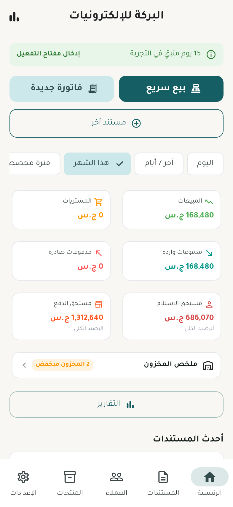 | 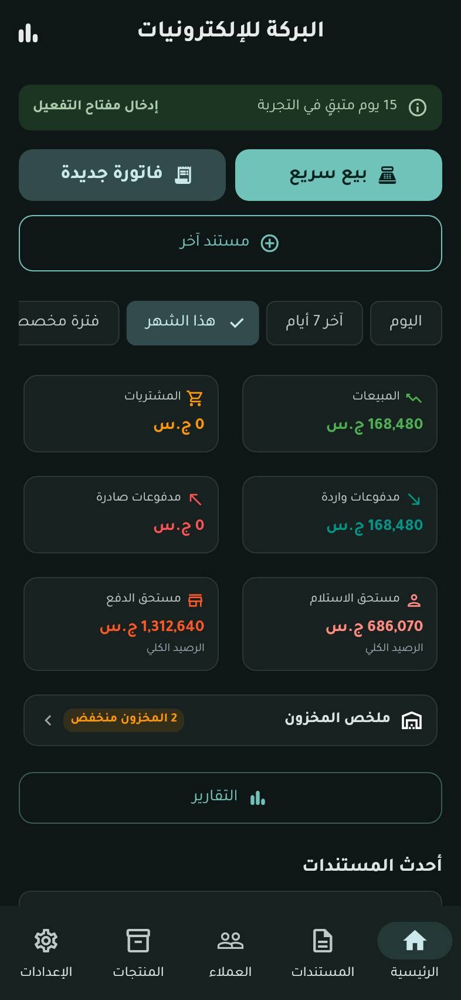 |

- **AR:** لوحة يومية: المبيعات والمشتريات والمدفوعات الواردة والصادرة للفترة،
  وما لك عند العملاء وما عليك للموردين، وتنبيه المخزون المنخفض. زر **بيع سريع**
  في المقدمة. وضع داكن كامل.
- **EN:** A daily dashboard with sales, purchases, money in and out for the
  period, what customers owe you and what you owe suppliers, and low-stock
  alerts. **Quick sale** is one tap away. Full dark mode.

## 2. البيع السريع (نقطة بيع) · Quick sale (POS)

| | | |
|---|---|---|
| 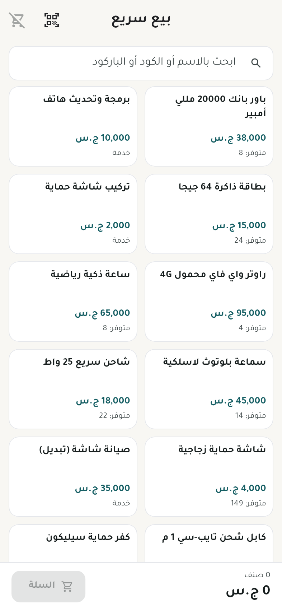 | 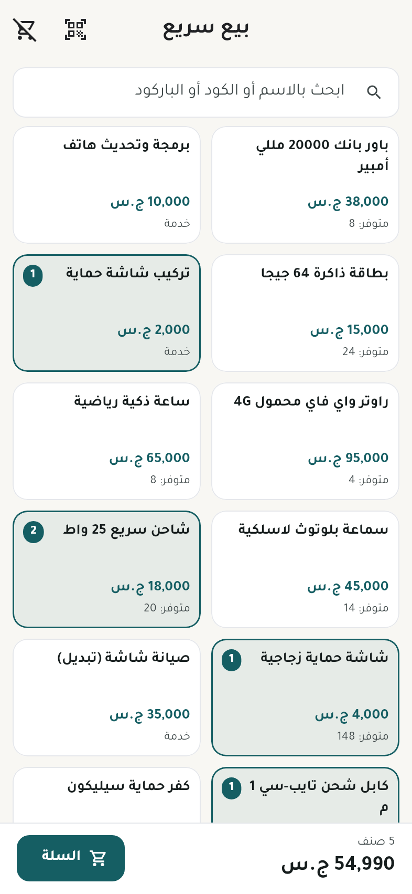 | 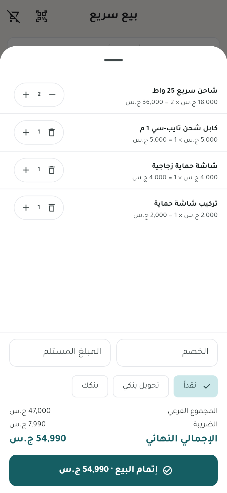 |

- **AR:** شبكة منتجات بلمسة واحدة، بحث بالاسم أو الكود، ومسح الباركود
  بالكاميرا. يعرض المتوفر لكل صنف ويمنع البيع فوق المخزون. السلة فيها تعديل
  الكميات والخصم وطريقة الدفع (نقداً، تحويل بنكي، بنكك…) والمبلغ المستلم
  والباقي. إتمام البيع يُنشئ فاتورة مدفوعة وإيصالاً ويخصم المخزون في عملية
  واحدة آمنة، ثم يطبع إيصال 80 مم أو يشاركه.
- **EN:** A one-tap product grid with search by name or code and camera
  barcode scanning. Each item shows stock on hand, and the cart won't sell
  more than you have. In the cart you set quantities, discount, payment
  method (cash, bank transfer, Bankak…) and amount received, and the change
  is calculated for you. Completing a sale creates a paid invoice and a
  receipt and deducts stock in one atomic transaction, then prints or shares
  an 80 mm receipt.

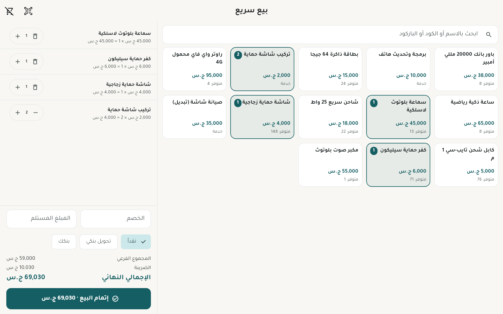

**AR:** على التابلت تظهر السلة بجانب المنتجات. **EN:** On tablets, the cart
sits beside the products.

## 3. الفواتير والمستندات · Invoices & documents

| | | |
|---|---|---|
| 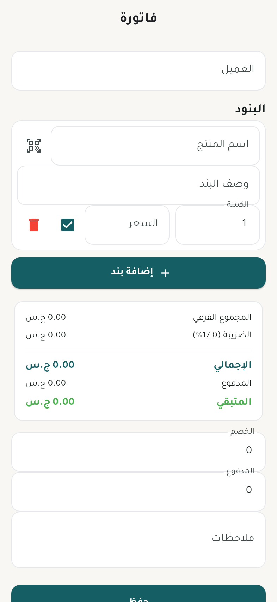 | 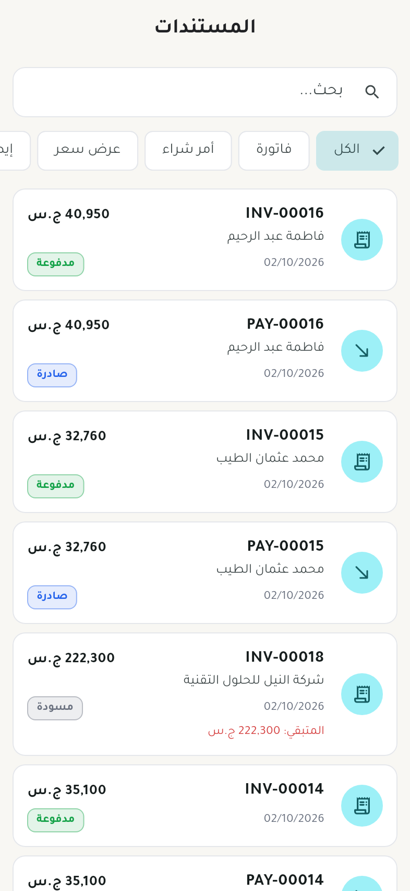 | 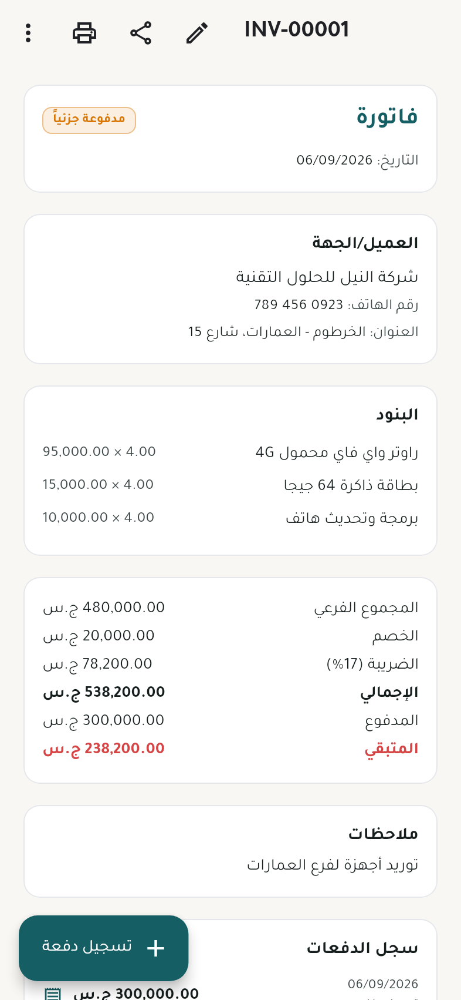 |

- **AR:** فواتير وعروض أسعار وأوامر شراء وإيصالات قبض وسندات صرف ومستندات
  مخصصة. حالات واضحة (مسودة، صادرة، مدفوعة جزئياً، مدفوعة، ملغاة)، وسجل
  دفعات لكل فاتورة، وتحويل عرض السعر إلى فاتورة.
- **EN:** Invoices, quotations, purchase orders, payment receipts, expense
  vouchers and custom documents. Clear statuses (draft, issued, partially
  paid, paid, cancelled), a payment history on every invoice, and one-step
  quotation-to-invoice conversion.

## 4. مستندات PDF احترافية · Professional PDFs

| A4 invoice | A4 quotation | 80 mm receipt |
|---|---|---|
| 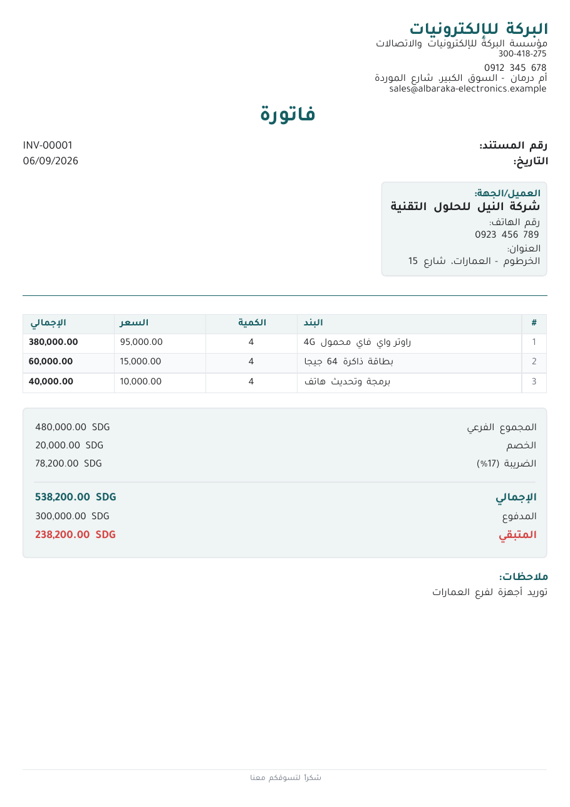 | 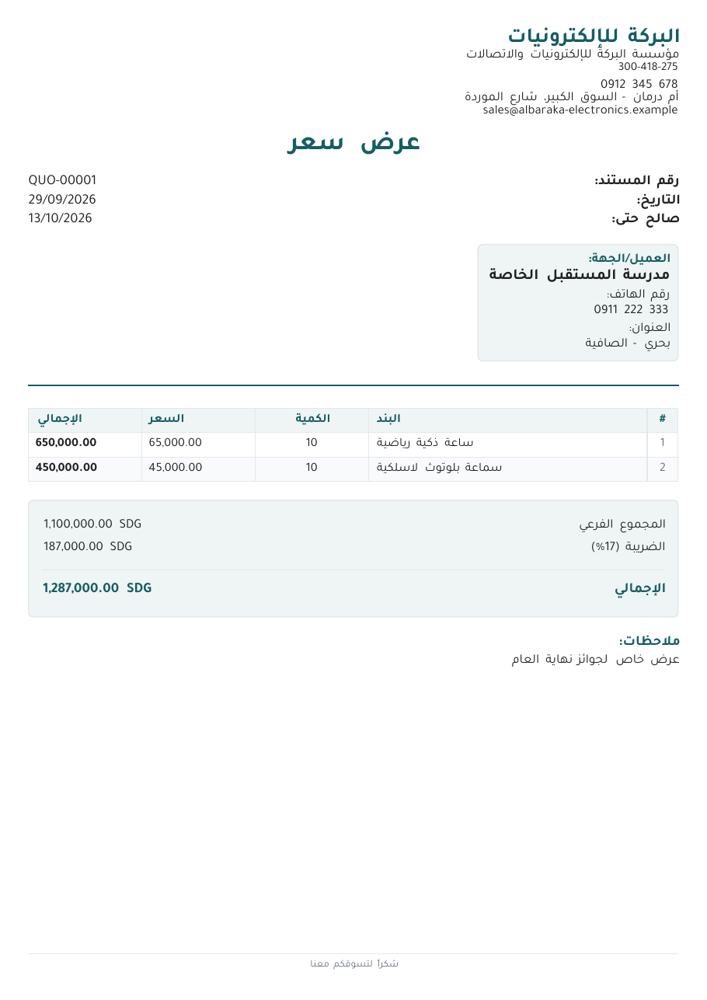 | 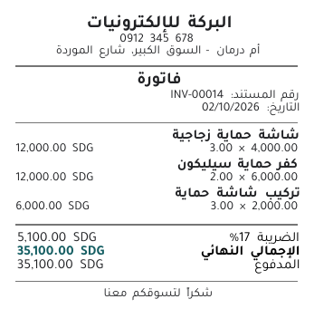 |

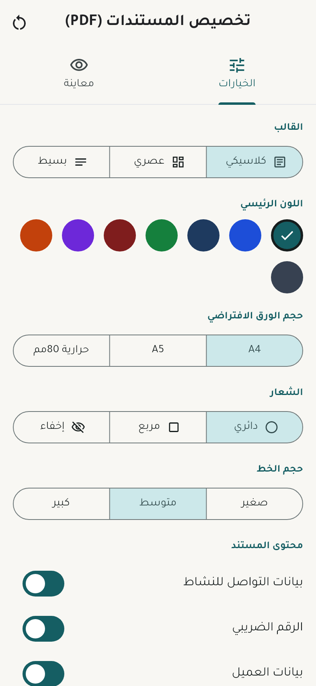

- **AR:** عربي سليم من اليمين لليسار، ومقاسات A4 وA5 وإيصال حراري 80 مم.
  شاشة **تصميم المستندات** فيها 3 قوالب، ولون مميز، وشكل الشعار، وحجم الخط،
  وإظهار أو إخفاء أي قسم، ونص التذييل، مع معاينة حية.
- **EN:** Correct right-to-left Arabic; A4, A5 and 80 mm thermal sizes.
  **Document design** offers 3 templates, accent colour, logo shape, text
  size, a toggle for each section and footer text, with a live preview.

## 5. العملاء والموردون · Customers & suppliers

| | |
|---|---|
| 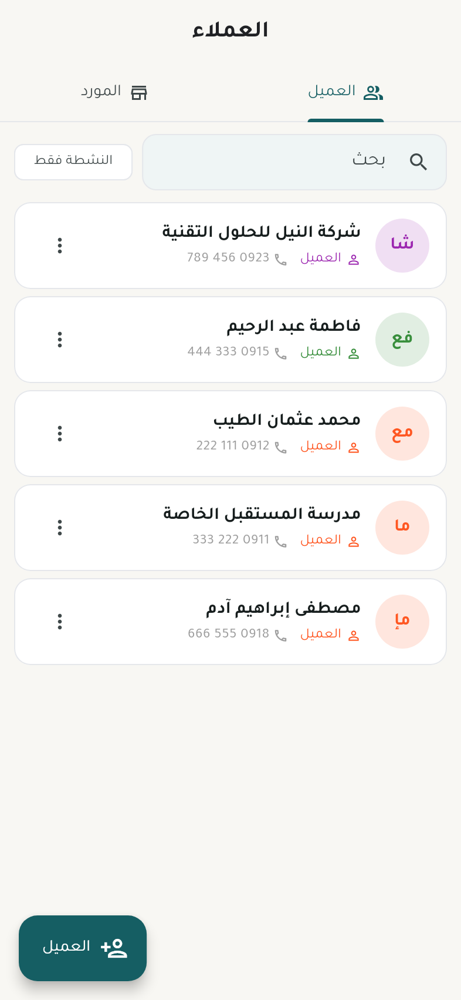 | 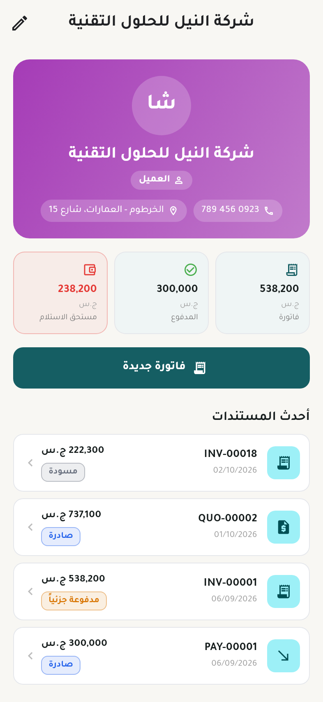 |

- **AR:** كشف حساب لكل عميل أو مورد: المفوتر والمدفوع والمستحق وكل مستنداته.
- **EN:** An account page for every customer or supplier showing invoiced,
  paid and outstanding amounts, plus all of their documents.

## 6. المنتجات والمخزون · Products & inventory

| | |
|---|---|
| 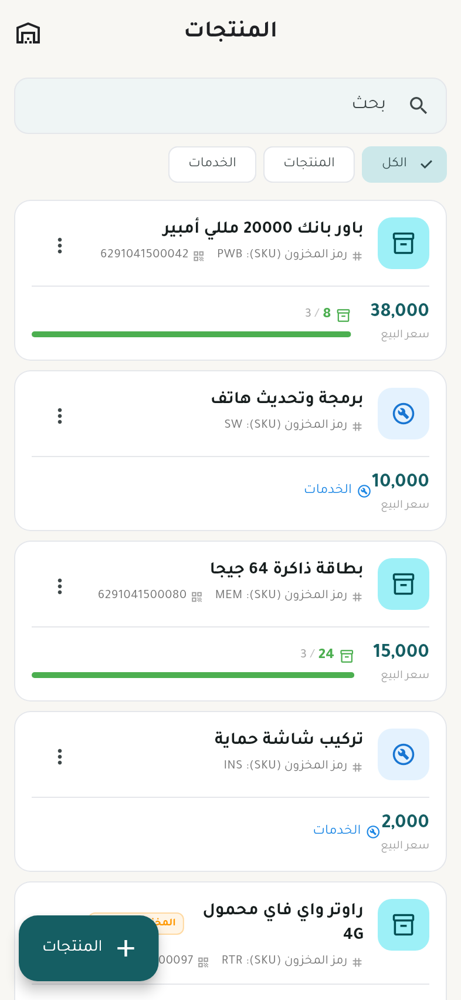 | 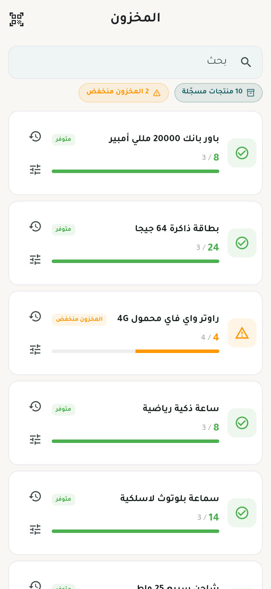 |

- **AR:** منتجات وخدمات بأسعار البيع والشراء والباركود. المخزون يتحرك
  تلقائياً مع الفواتير وأوامر الشراء، مع حد أدنى وتنبيه، وتسويات بسبب (تالف،
  جرد…)، وسجل حركة لكل صنف.
- **EN:** Products and services with sale and purchase prices and barcodes.
  Stock moves automatically with invoices and purchase orders. There are
  minimum levels and alerts, adjustments with a reason (damage, stock
  count…), and a movement history for every item.

## 7. التقارير · Reports

| | |
|---|---|
| 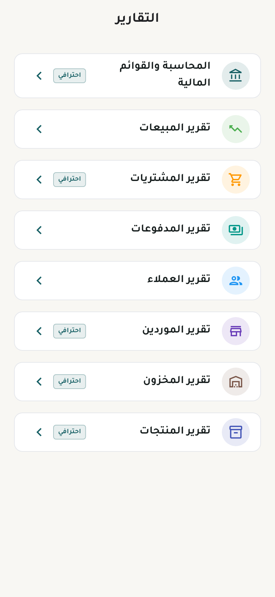 | 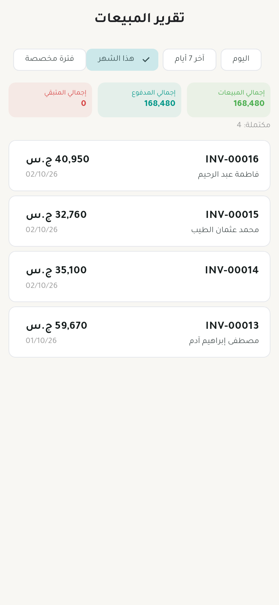 |

**AR:** تقارير المبيعات والمشتريات والمدفوعات والعملاء والموردين والمخزون
والمنتجات، بفترات جاهزة أو مخصصة. **EN:** Sales, purchases, payments,
customer, supplier, inventory and product reports, for preset or custom
periods.

## 8. المحاسبة بالقيد المزدوج · Double-entry accounting

| Income statement | Balance sheet | Trial balance |
|---|---|---|
| 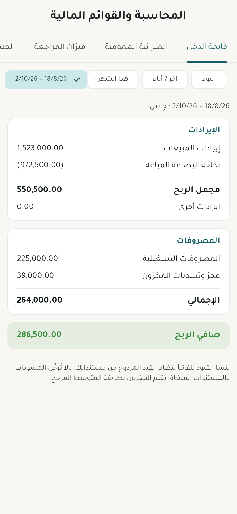 | 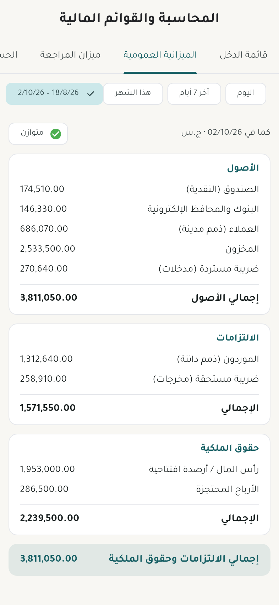 | 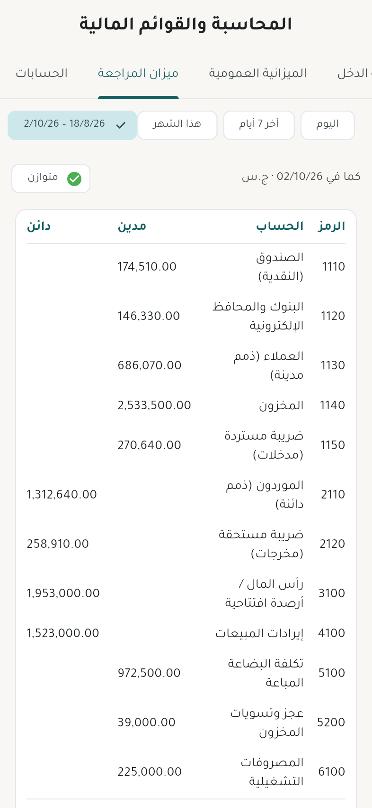 |

| Accounts | Account ledger |
|---|---|
| 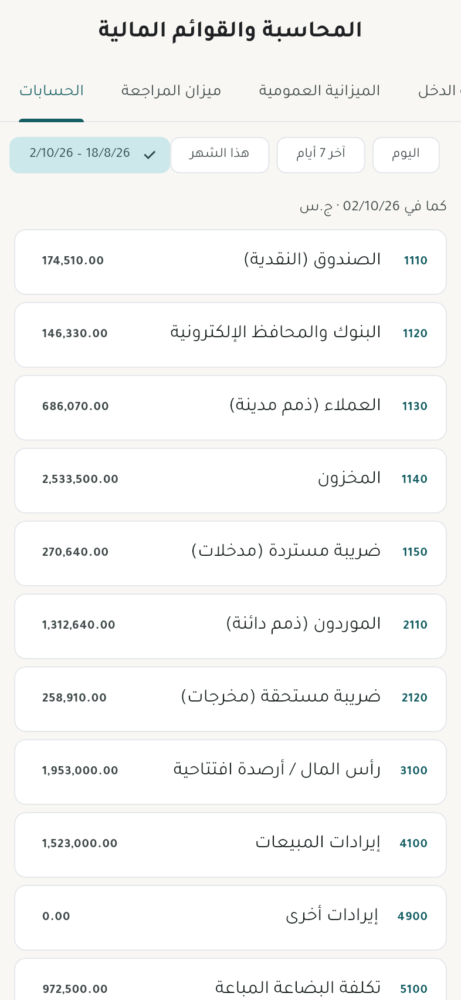 | 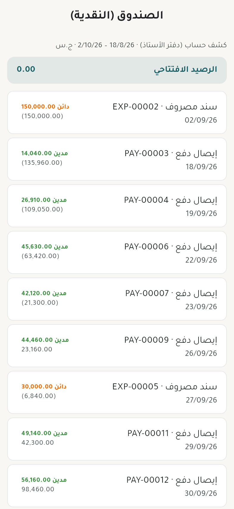 |

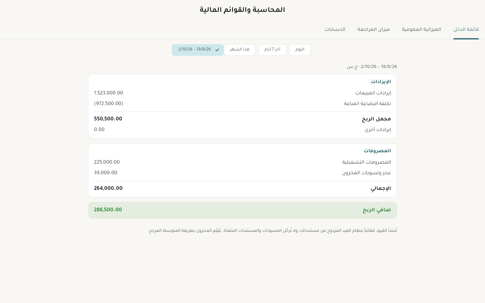

- **AR:** قيود يومية تُنشأ تلقائياً من مستنداتك وفق المعايير المحاسبية: دليل
  حسابات (أصول، التزامات، حقوق ملكية، إيرادات، مصروفات)، وتكلفة المبيعات
  بطريقة المتوسط المرجح (IAS 2)، والضريبة المحصلة والمدفوعة في حسابات منفصلة.
  - **قائمة الدخل:** الإيرادات، تكلفة البضاعة، مجمل الربح، المصروفات، صافي الربح.
  - **الميزانية العمومية:** الأصول = الالتزامات + حقوق الملكية، مع مؤشر "متوازن".
  - **ميزان المراجعة** و**كشف حساب** لكل حساب برصيد افتتاحي وجارٍ وختامي.
    النقر على أي حركة يعرض القيد كاملاً (مدين/دائن).
  - لا تُرحَّل المسودات والمستندات الملغاة، وتُفصل الدفاتر حسب العملة.
- **EN:** Journal entries are generated automatically from your documents,
  following standard accounting practice. That means a chart of accounts
  (assets, liabilities, equity, revenue, expenses), cost of sales at
  weighted-average cost (IAS 2), and tax collected and paid in separate
  accounts.
  - **Income statement:** revenue, cost of goods sold, gross profit,
    expenses, net profit.
  - **Balance sheet:** assets = liabilities + equity, with a "Balanced"
    check.
  - **Trial balance**, plus an **account ledger** for each account with
    opening, running and closing balances. Tap any line to see the full
    debit/credit entry.
  - Drafts and cancelled documents are never posted, and each currency
    keeps its own books.

## 9. الإعدادات والدعم · Settings & support

| | |
|---|---|
| 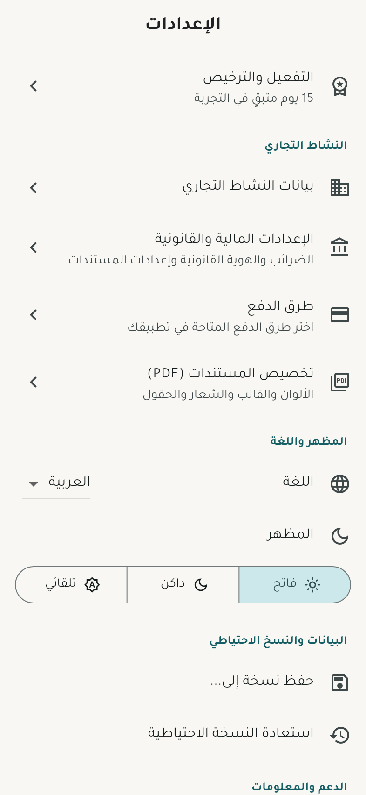 | 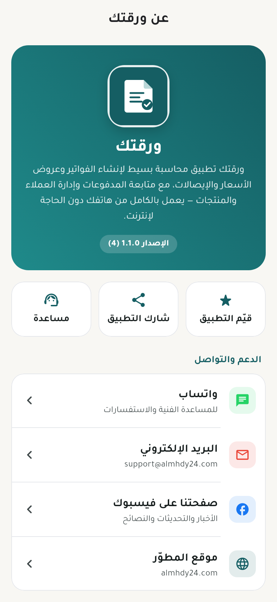 |

**AR:** اللغة (عربي/إنجليزي)، والمظهر (فاتح/داكن/النظام)، وبيانات النشاط
والضرائب وطرق الدفع، والنسخ الاحتياطي والاستعادة. صفحة "حول" فيها روابط الدعم
عبر واتساب والبريد وفيسبوك. **EN:** Language (Arabic/English), appearance
(light/dark/system), business details, taxes and payment methods, and backup
and restore. The About page links to support on WhatsApp, email and
Facebook.

## 10. التابلت · Tablets

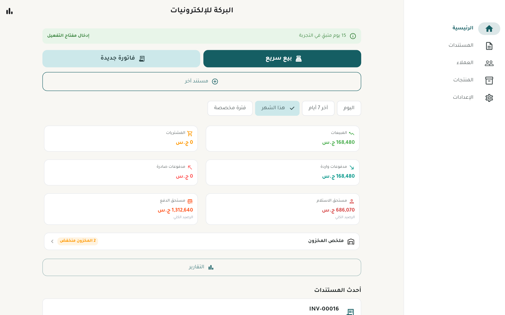

**AR:** شريط تنقل جانبي ومحتوى متمركز على الشاشات الكبيرة. **EN:** A side
navigation rail and centred content on large screens.

---

### إعادة توليد اللقطات · Regenerating

```sh
SHOWCASE=1 flutter test test/showcase/showcase_test.dart --update-goldens
SHOWCASE=1 flutter test test/showcase/showcase_test.dart --update-goldens --dart-define=LANG=en
for l in ar en; do for f in docs/showcase/$l/*.pdf; do
  pdftoppm -png -r 110 -f 1 -l 1 -singlefile "$f" "${f%.pdf}"; done; done
```

The demo store is defined in `test/showcase/store_seed.dart`. Without
`SHOWCASE` set, the showcase tests are skipped, so normal `flutter test` and
CI are unaffected.
